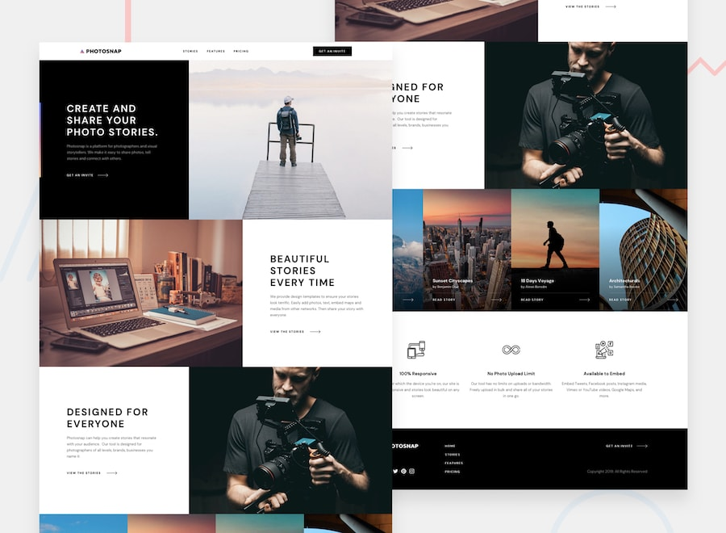

# Frontend Mentor - Photosnap Website



## Table of contents

- [Overview](#overview)
  - [The challenge](#the-challenge)
  - [Links](#links)
- [My process](#my-process)
  - [Built with](#built-with)
  - [What I learned](#what-i-learned)
- [Author](#author)

## Overview

### The challenge

Your challenge is to build out this multi-page website — Home, Stories, Features and Pricing — and get it looking as close to the design as possible.

You can use any tools you like to help you complete the challenge. So if you've got something you'd like to practice, feel free to give it a go.

Your users should be able to:

- View the optimal layout for each page depending on their device's screen size
- See hover states for all interactive elements throughout the site
- Open and close the navigation menu on mobile
- Switch the Pricing page between monthly and yearly prices

Expected behaviour:

- The "Get an invite" call-to-action throughout the site is an anchor tag that doesn't link anywhere yet.
- Each story on the Stories page is wrapped in an anchor tag, as each would link off to its own site.
- The "Pick plan" call-to-actions in the pricing tiers are anchor tags that don't link anywhere yet.

### Links

- Live Site URL: [github pages](https://gerardocianciulli.github.io/Photosnap-multi-page-website/)

## My process

### Built with

- Semantic HTML5 markup
- CSS custom properties
- CSS Grid
- Flexbox
- Desktop-first workflow
- Media Queries
- React
- Typescript
- jQuery
- Vite (multi-page build)
- gh-pages

### What I learned

**A multi-page site with one React codebase.** Vite can treat every HTML file as its own entry point, so each page keeps a real URL (`stories.html`, `pricing.html`…) while sharing the same components. The `base` option prefixes every asset with the GitHub Pages repository path.

```ts
export default defineConfig({
  base: process.env.BASE_PATH ?? '/Photosnap-multi-page-website/',
  plugins: [react()],
  build: {
    rollupOptions: {
      input: {
        home: resolve(root, 'index.html'),
        stories: resolve(root, 'stories.html'),
        features: resolve(root, 'features.html'),
        pricing: resolve(root, 'pricing.html'),
      },
    },
  },
});
```

Each entry file only says which page to mount; the header and footer come from a shared `Layout`:

```tsx
// src/entries/pricing.tsx
import { mountPage } from '../lib/mountPage';
import { PricingPage } from '../pages/PricingPage';

mountPage(<PricingPage />);
```

**Using jQuery inside React without fighting it.** React renders the markup once, and jQuery attaches the interactions (mobile menu, Monthly/Yearly switch) from a `useEffect`. Namespaced events make the cleanup a one-liner, which also keeps React's Strict Mode double-mount from binding handlers twice.

```ts
export function initBillingToggle(): Cleanup {
  const $section = $('.pricing-plans');
  const $switch = $section.find('.billing-switch');

  const setPeriod = (period: 'monthly' | 'yearly') => {
    const yearly = period === 'yearly';
    $switch.attr('aria-checked', String(yearly));
    $section.find('[data-monthly]').each(function () {
      const $el = $(this);
      $el.text(String($el.attr(yearly ? 'data-yearly' : 'data-monthly')));
    });
  };

  $switch.on('click.billing', () => {
    setPeriod($switch.attr('aria-checked') === 'true' ? 'monthly' : 'yearly');
  });

  return () => $switch.off('.billing');
}
```

```tsx
export function PricingPlans() {
  useEffect(() => initBillingToggle(), []);
  // …
}
```

**Responsive images with Typescript-checked paths.** `import.meta.glob` turns the whole `/assets` folder into fingerprinted URLs, and a small `<picture>` component swaps the desktop, tablet and mobile exports with the same breakpoints as the CSS.

```tsx
<picture className={className}>
  {mobile && <source media={MEDIA_MOBILE} srcSet={asset(mobile)} />}
  {tablet && <source media={MEDIA_TABLET} srcSet={asset(tablet)} />}
  
</picture>
```

**A comparison table that reflows on mobile.** The Pricing table stays a real `<table>` for screen readers. On mobile each row becomes a three-column grid, and the plan name above every check mark comes from a `data-label` attribute instead of duplicated markup:

```css
@media (max-width: 47.9375rem) {
  .compare__table tbody tr {
    display: grid;
    grid-template-columns: repeat(3, 1fr);
  }

  .compare__table td::before {
    content: attr(data-label);
    font-size: 0.625rem;
    opacity: 0.5;
  }
}
```

## Author

- Portfolio - [Gerardo Cianciulli](https://www.behance.net/gerardo-cianciulli)
- Frontend Mentor - [Gerardo Cianciulli](https://www.frontendmentor.io/profile/GerardoCianciulli)
- Linkedin - [Gerardo Cianciulli](https://www.linkedin.com/in/gerardo-cianciulli/)
